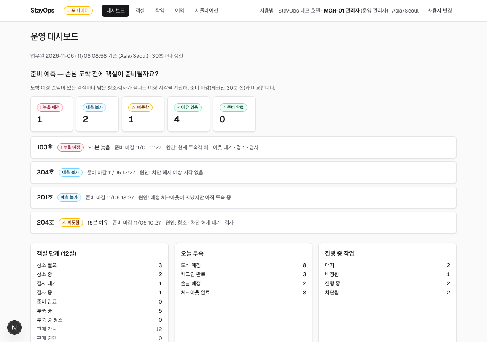
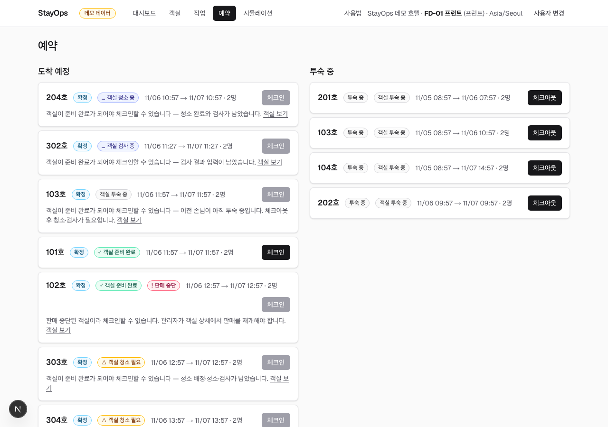

# StayOps — 객실 준비 예측과 하우스키핑 운영

호텔·레지던스에서 **"다음 손님이 도착하기 전에 이 객실이 준비될까?"**에 답하는 운영 지원 도구의 MVP입니다.
청소·검사 작업과 차단 사유(린넨 부족, 방해 금지 등)를 한 흐름으로 묶고, 준비가 늦어질지를 **근거와 함께** 미리 보여 줍니다.

> **처음이라면:** [프로젝트 개요](docs/OVERVIEW.md)에 무엇을 만들었고, 어떻게 진행했고, AI를 어떻게 활용·검증했는지와 읽는 순서를 정리했습니다.

| 대시보드 — 준비 예측 | 예약 — 체크인 전 안내 |
|---|---|
|  |  |

## 핵심 기능

- **준비 예측:** 도착 예정 객실마다 남은 일(퇴실 대기 → 청소 → 검사)이 끝나는 시각을 계산해 준비 마감과 비교합니다. `늦을 예정` `빠듯함` `여유 있음` `준비 완료` `예측 불가`로 보여 주고, 정보가 부족하면 짐작하지 않고 이유와 함께 `예측 불가`로 표시합니다.
- **예외까지 다루는 객실 흐름:** 배정 → 청소 → 검사 → 체크인. 차단과 해제, 검사 실패 후 재청소, 투숙 중 청소 중 체크아웃 거부, 판매 중단, 취소 후 재정비까지 처리합니다.
- **역할별 화면:** 관리자 · 프런트 · 하우스키핑 · 검사 역할마다 보이는 메뉴와 버튼이 다릅니다. 라이트·다크 모드를 지원합니다.
- **운영 정책 시뮬레이션:** 80실·14일 데모 데이터로 배정 방식 3가지를 비교합니다. 예: 정시 준비율 81.5% → 96.3%(마감 급한 객실부터 배정).

## 빠른 시작

요구 환경: JDK 21 · Node 22 + pnpm 10 · Docker. 저장소 루트에서 **터미널 3개**로 실행합니다.

```bash
docker compose up -d                                                         # 1) DB
cd apps/api && ./gradlew bootRun --args='--spring.profiles.active=demo'       # 2) API :8080
cd apps/web && nvm use && pnpm install && pnpm dev                           # 3) Web :3000
```

http://localhost:3000 에서 **[사용 설명서 보기]**로 시작하거나, `MGR-01 관리자`를 골라 바로 둘러보세요.
데모 데이터는 매일 새벽 4시에 지금 시각 기준으로 새로 만들어집니다. 설정과 개발 명령은 [`docs/DEVELOPMENT.md`](docs/DEVELOPMENT.md)에 있습니다.

> 모든 데이터는 직접 만든 **데모 데이터**이며 결과를 실제 운영 성과로 표현하지 않습니다. 인증은 직원을 골라 쓰는 **데모 방식**으로, 보안 수단이 아닙니다([ADR-005](docs/decisions/ADR-005-demo-authentication.md)).

## 문서

| 문서 | 내용 |
|---|---|
| [프로젝트 개요](docs/OVERVIEW.md) | 전체 요약, 진행 과정, AI 활용·검증, 찾은 결함 |
| [AI 활용 개발 과정](docs/process/AI_DEVELOPMENT_PROCESS.md) | 단계별 기록, 사람·AI 역할 분담, AI 오류 교정 사례 |
| [사용 설명서](docs/USER_GUIDE.md) | 역할별 할 일, 상태별 가이드, 막혔을 때 해결 방법 (앱에서는 `/guide`) |
| [테스트 케이스](docs/qa/TEST_CASES.md) · [운영 테스트 보고서](docs/qa/OPERATIONAL_TEST_REPORT.md) | 실제 서비스에서 확인한 결과와 증거 캡처 |
| [설계 문서 v4.1](docs/v4.1/) · [ADR](docs/decisions/) | 도메인 규칙(02가 단일 기준), 기술 결정 7건 |
| [개발 가이드](docs/DEVELOPMENT.md) · [배포 구성](docs/deploy/DEPLOYMENT.md) | 검증 명령, API 계약, 배포(실제 배포 안 함) |

## 기술 스택과 검증

| 구성 | 기술 | 테스트 |
|---|---|---|
| API | Spring Boot 4 · Kotlin · PostgreSQL 17 · Flyway | 234 (실제 DB, 무작위 동시 명령 + 불변식, API 계약) |
| Web | Next.js 16 · React 19 · TypeScript · TanStack Query | 43 |
| 데모 데이터셋 생성기 | Python 3.11 · uv | 22 (바이트 단위 재현성) |
| 브라우저 | Playwright · axe | E2E 8 · 운영 테스트 15 (라이트·다크 접근성 포함) |
| 배포·CI | Docker · Terraform(AWS) · GitHub Actions | 구성·로컬 검증만, 실제 배포 안 함 |

## 한계

- 인증은 데모 방식입니다. 실제 인증(OIDC) 도입 단계는 [ADR-007](docs/decisions/ADR-007-auth-before-deployment.md)에 정리했습니다.
- 작업 소요시간·준비 여유(30분) 같은 값은 데모용 가정이며 현장 실측치가 아닙니다.
- 실제 배포와 화면 낭독기 수동 점검은 하지 않았습니다.
