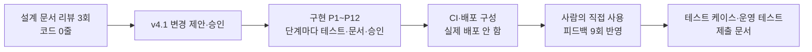

# StayOps — 과제 제출 문서

> **한 줄 요약:** 호텔·레지던스에서 "다음 손님이 도착하기 전에 이 객실이 준비될까?"에 답하는 운영 지원 도구의 MVP를, AI 코딩 에이전트(Claude Code)와 함께 **설계 리뷰 → 단계별 구현 → 다층 검증 → 사람의 직접 사용과 개선**의 순서로 만들었습니다.
>
> 모든 데이터는 직접 만든 **데모 데이터**이며, 결과를 실제 운영 성과로 표현하지 않습니다. 인증은 데모용 헤더로, 보안 수단이 아닙니다([ADR-005](decisions/ADR-005-demo-authentication.md), [ADR-007](decisions/ADR-007-auth-before-deployment.md)).

## 평가자를 위한 읽는 순서

| 순서 | 문서 | 무엇을 볼 수 있나 | 소요 |
|---|---|---|---|
| 1 | 이 문서 | 전체 요약 | 5분 |
| 2 | [AI 활용 개발 과정](process/AI_DEVELOPMENT_PROCESS.md) | 사람·AI 역할 분담, 단계별 기록, 검증 방법, **AI가 틀린 것을 잡은 사례** | 10분 |
| 3 | [README](../README.md) → 빠른 시작 | 직접 실행해 보기 (터미널 3개) | 10분 |
| 4 | [사용 설명서](USER_GUIDE.md) (앱에서는 `/guide`) | 화면 사용법 | 5분 |
| 5 | [운영 테스트 결과 보고서](qa/OPERATIONAL_TEST_REPORT.md) · [테스트 케이스](qa/TEST_CASES.md) | 실제 서비스에서 확인한 결과와 증거 캡처 | 5분 |
| 6 | [설계 결정(ADR)](decisions/) · [도메인 규칙](v4.1/02_DOMAIN_AND_API.md) | 기술 판단의 근거 | 필요 시 |

## 1. 무엇을 만들었나

### 문제
객실 상태판이나 청소 배정 기능은 기존 PMS에도 있습니다. 이 프로젝트는 그 다음 질문에 집중했습니다.
- 다음 손님이 오기 전에 **준비가 끝날지 미리 알 수 있는가**, 늦는다면 **원인이 무엇인가**
- 작업 배정 방식을 바꾸면 **얼마나 나아지는가** (데모 데이터로 비교)

### 결과물

| 구성 | 내용 |
|---|---|
| 웹 (Next.js 16, TypeScript) | 대시보드 · 객실/객실 상세 · 작업 보드 · 예약 · 시뮬레이션 · 사용 설명서. 역할(관리자·프런트·하우스키핑·검사)별 화면, 라이트·다크 모드 |
| API (Spring Boot 4 + Kotlin, PostgreSQL 17) | 체크인/아웃, 작업 배정·시작·차단·완료·검사·취소, 판매 중단, 재정비, 준비 예측, 정책 시뮬레이션. 모든 명령에 멱등 키, 객실 단위 잠금, RFC 9457 오류 |
| 데모 데이터셋 생성기 (Python) | seed가 같으면 바이트 단위로 같은 파일을 만드는 생성기. Python↔Kotlin 계약 fixture로 연결 |
| 배포 구성 (실제 배포 안 함) | Dockerfile, AWS Terraform(ECS Fargate·RDS·ALB), GitHub Actions CI |
| 문서 | 설계 v1~v4.1, ADR 7개, 사용 설명서, 테스트 케이스, 운영 테스트 보고서, AI 활용 과정 기록 |

### 핵심 기능 세 가지
1. **준비 예측:** 도착 예정 객실마다 남은 일(퇴실 대기 → 청소 → 검사)이 끝나는 시각을 계산해 준비 마감과 비교합니다. 늦을 예정 · 빠듯함 · 여유 있음 · 준비 완료 · **예측 불가** 다섯 가지로 보여 주고, 근거를 함께 보여 줍니다. 정보가 부족하면 짐작하지 않고 '예측 불가'와 그 이유를 표시합니다.
2. **예외까지 다루는 객실 흐름:** 차단(방해 금지·린넨 부족 등), 검사 실패 → 재청소, 투숙 중 청소 중 체크아웃 거부, 판매 중단, 취소 후 재정비까지 상태 규칙을 한 문서([02](v4.1/02_DOMAIN_AND_API.md))로 정하고 DB 제약·테스트로 지킵니다.
3. **운영 정책 시뮬레이션:** 80실·14일 데모 데이터로 배정 방식 세 가지를 비교합니다. 예: 정시 준비율 기준 81.5% → 마감 급한 객실부터 96.3%.

## 2. 어떻게 진행했나



| 단계 | 기간 | 한 일 | 결과 |
|---|---|---|---|
| 설계 리뷰 | 11-04 오전 | AI가 설계 문서 v1·v2·v4를 읽고 구현이 막히는 지점을 보고 → 사람이 개정 → v4.1 변경 제안(C1~C10, 신규 발견 N1~N3)을 사람이 승인 | 가장 영향이 큰 결정("작업 시작 여부 = 최초 시작 시각 존재")이 코드 작성 전에 나옴 |
| 환경 구성 | 11-04 | Docker, JDK 21, uv 설치, git | 관리자 암호·셸 설정 등 권한 경계는 우회하지 않고 사람에게 넘김 |
| 구현 P1~P12 | 11-04 16:04~20:09 | 골격 → 스키마 → 명령 기반 → 예약 → 작업 → 검사·예외 → 동시성 → 준비 예측 → API 계약 → 화면 → 생성기 → 시뮬레이션 → E2E·점검·배포 구성 | 단계마다 "계획 → 구현 → 테스트 → 문서 동기화 → 커밋 → 보고 → 사람 승인" |
| CI·README | 11-04 20시 | GitHub Actions 7개 job, 제출용 README | — |
| 사람의 직접 사용 | 11-04 20시~11-06 | 지원자가 실제로 써 보며 스크린샷·짧은 피드백 9회 | 다크 모드, 체크인 안내, 쉬운 표현, 사용 설명서, 매일 새로 만드는 데모 데이터 |
| QA·제출 | 11-06 | 테스트 케이스 15개, 실행 중 서비스 대상 운영 테스트 15/15, 이 문서 | 운영 테스트에서 결함 1건 추가 발견 |

자세한 단계별 기록은 [AI 활용 개발 과정](process/AI_DEVELOPMENT_PROCESS.md) §3에 있습니다.

## 3. AI를 어떻게 활용했나

### 역할 분담
| 사람 (지원자) | AI (Claude Code) |
|---|---|
| 문제 정의, 설계 문서 작성·개정, 수정 지시서 | 문서 리뷰와 빈틈·충돌 보고, 변경 제안서 |
| 권장안 승인과 미결정 사항 결정, 범위 지시("배포 없이", "CI 추가") | 단계별 구현·테스트·문서 동기화·커밋 |
| **직접 사용해 보고 피드백** (화면·표현·사용성) | 원인 분석 → 수정 → 재발 방지 테스트 추가 |
| 관리자 암호 입력, 셸 설정 등 권한이 필요한 일 | 권한 경계에서 멈추고 사람에게 안내 |

### 활용 원칙 (실제로 효과가 있었던 것)
1. **코드 전에 AI를 리뷰어로:** 설계 충돌을 먼저 찾게 했습니다. 되돌리는 비용이 가장 작을 때입니다.
2. **AI가 따를 규칙과 보고 형식을 먼저 문서로:** [하네스 문서](v4.1/06_CLAUDE_CODE_HARNESS.md)에 단계 순서, 변경 금지 규칙, 보고 항목을 정했습니다. 보고 항목에는 "실행하지 못한 검증과 이유"를 넣었습니다.
3. **작은 단계 + 사람의 승인:** 단계마다 멈추고 보고하게 해서, 짧은 승인으로도 방향을 통제했습니다.
4. **AI가 쓴 테스트도 검증 대상:** 수정을 되돌렸을 때 테스트가 실패하는지 확인했습니다. 실제로 통과는 하지만 아무것도 검증하지 않던 테스트를 찾아냈습니다.
5. **결정적(재현 가능한) 장치:** seed 고정, 바이트 일치 fixture, 전용 테스트 DB 초기화를 두어 AI 결과를 재현하고 비교했습니다.
6. **자동 검증은 사람의 눈을 대체하지 못함:** 자동 테스트 수백 개를 통과한 뒤에도, 사람이 화면을 보고 다크 모드·표현·사용성 문제를 찾았습니다. 찾은 뒤에는 자동 검사로 바꿔 넣었습니다.

### 결함을 어떻게 찾았나 — 총 10건, 모두 수정

| # | 결함 | 찾은 방법 | 찾은 주체 |
|---|---|---|---|
| 1 | 동시 재배정 시 배정 해제 시각이 배정 시각보다 앞섬 | 무작위 명령 시퀀스 + DB 불변식 테스트 | 자동 검증 |
| 2 | 준비 예측 합계가 0.752초 어긋남(반올림) | 실행 중인 API 대상 smoke 테스트 | 자동 검증 |
| 3 | 대화상자를 닫을 때 포커스가 돌아오지 않음 | 브라우저 E2E | 자동 검증 |
| 4 | 요청 본문을 크기 제한 없이 파싱 | 보안 점검(코드 검토) | AI 검토 |
| 5 | 다크 모드에서 카드 글자가 안 보임 | **사람이 화면을 보고 지적** | 사람 |
| 6 | 개발 모드에서 대화상자가 열리지 않음(#3 수정의 부작용) | AI가 #5 확인 중 화면 캡처 | AI 확인 |
| 7 | 준비 안 된 객실도 체크인 버튼이 눌리고 영어 오류만 보임 | **사람이 직접 써 보고 지적** | 사람 |
| 8 | 이전 버전 API에서 모든 체크인 버튼이 꺼짐 | AI가 #7 수정 후 화면 캡처 | AI 확인 |
| 9 | 정시 준비율 이중 반올림(문서 81.6% ↔ 실제 81.546%) | 실행 중 서비스 대상 운영 테스트 | 자동 검증 |
| 10 | 문구 변경 후 API 계약 스냅샷 재생성 누락 | 계약 테스트 실패 | 자동 검증 |

이 밖에 AI가 쓴 테스트 자체의 오류(잘못된 기대값, 경쟁 조건, 아무것도 검증하지 않는 테스트)도 여러 건 찾아 고쳤습니다([§6](process/AI_DEVELOPMENT_PROCESS.md#6-ai가-틀린-것과-교정-사례)).

## 4. 품질 근거

| 검증 | 결과 | 비고 |
|---|---|---|
| 백엔드 단위·통합 | **234 통과** | 실제 PostgreSQL(Testcontainers), DB 제약 37개, 무작위 동시 명령 + 불변식 6종, OpenAPI 계약 |
| 웹 단위 | **43 통과** | 오류 코드별 안내, 역할별 버튼, 사용 설명서-문서 동기화 |
| 데모 데이터셋 생성기 | **22 통과** | 재현성, 시간대(DST), 언어 간 계약 |
| E2E (production build) | **8 통과** | 핵심 흐름·예외 흐름·시뮬레이션·키보드·보안 헤더, 접근성 axe 라이트·다크 |
| 운영 테스트 (실행 중 서비스) | **15/15 통과** | [보고서](qa/OPERATIONAL_TEST_REPORT.md), 증거 캡처 12장 |
| 보안 점검 | 비밀 유출 0, IaC 검사 0 실패 | [보안·접근성 점검](deploy/SECURITY_REVIEW.md) |
| CI | 7개 job 정의 | 원격 저장소가 없어 GitHub에서 실행은 미확인 |

## 5. 기술적 판단 (ADR)

| ADR | 결정 |
|---|---|
| [001](decisions/ADR-001-repository-structure.md) | 하나의 저장소, 별도 monorepo 도구 없음 |
| [002](decisions/ADR-002-runtime-toolchain.md) | JDK 21 · Node 22 · Python 3.11 · PostgreSQL 17 |
| [003](decisions/ADR-003-command-locking.md) | 객실 → 예약 → 작업 순서의 비관적 잠금, 명령 시각은 잠금 이후 (개정 2회) |
| [004](decisions/ADR-004-reservation-overlap-constraint.md) | 예약 겹침을 PostgreSQL exclusion constraint로 차단 |
| [005](decisions/ADR-005-demo-authentication.md) | 데모 헤더 인증 — 보안 수단 아님을 명시 |
| [006](decisions/ADR-006-api-contract.md) | 서버 코드에서 OpenAPI 생성 → 프런트 타입 생성, 계약 테스트 |
| [007](decisions/ADR-007-auth-before-deployment.md) | 배포 전 인증: 데모 헤더 유지, 실제 인증 도입 단계 기록 |

## 6. 한계와 다음 단계

| 한계 | 다음 단계 |
|---|---|
| 데모 헤더 인증 | ADR-007의 OIDC 도입 단계 |
| 실제 배포·CD 없음 | Terraform apply, OIDC 기반 CD (구성은 [DEPLOYMENT](deploy/DEPLOYMENT.md)에 준비) |
| CI를 GitHub에서 실행하지 못함 | 원격 저장소 생성 후 첫 실행 확인 |
| 실제 운영 데이터·현장 검증 없음 | 현장 인터뷰와 실제 소요시간으로 가정값 교체 |
| 미결정 정책(객실 이동, 노쇼, 이동 시간 등) | [02 §11 OPEN](v4.1/02_DOMAIN_AND_API.md) 목록 |
| 화면 낭독기 수동 점검 안 함 | VoiceOver 점검 |

## 7. 실행해 보기 (요약)

```bash
docker compose up -d                                                           # 터미널 1 (저장소 루트)
cd apps/api && ./gradlew bootRun --args='--spring.profiles.active=demo'         # 터미널 2
cd apps/web && nvm use && pnpm install && pnpm dev                             # 터미널 3 → http://localhost:3000
```
첫 화면의 **[사용 설명서 보기]** 버튼부터 시작하세요. 요구 환경과 자세한 내용은 [README](../README.md)에 있습니다.
