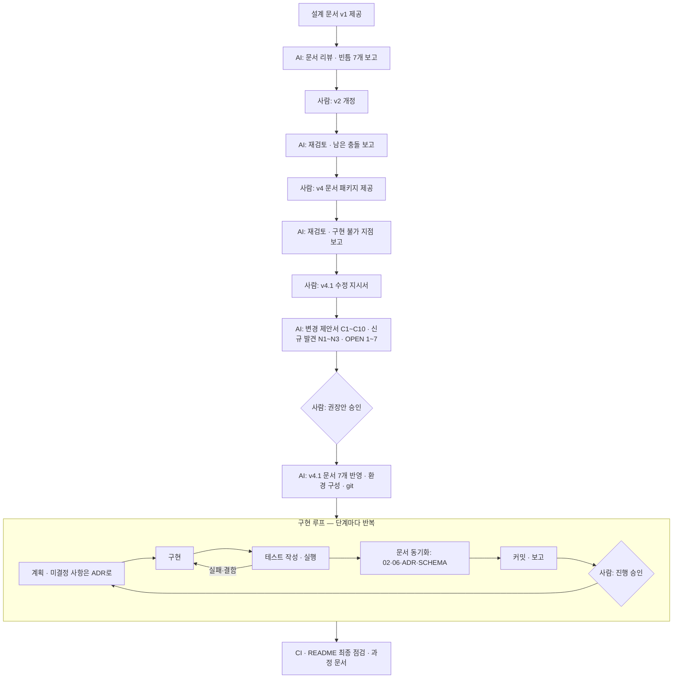

# AI 활용 개발 과정 기록 — StayOps

> 이 문서는 StayOps MVP를 **AI 코딩 에이전트(Claude Code, 모델 Claude Opus 5.5)**와 함께 만든 과정을 단계별로 기록합니다.
> 무엇을 사람이 정했고 무엇을 AI가 했는지, AI 결과를 어떻게 검증했는지, AI가 틀린 것을 어떻게 잡았는지를 남기는 것이 목적입니다.
> 모든 수치와 사실은 git 이력(`git log`), 진행 현황 표([06 §1.1](../v4.1/06_CLAUDE_CODE_HARNESS.md)), 변경 이력([08](../v4.1/08_V4.1_CHANGE_LOG.md))에서 확인할 수 있습니다.

## 1. 개요

| 항목 | 내용 |
|---|---|
| 기간 | 2026-11-04, 한 세션 (첫 커밋 16:04 → 마지막 구현 커밋 20:09, 18개 커밋) |
| 결과물 | Spring Boot 4 + Kotlin API, Next.js 16 웹, Python 합성 데이터 생성기, Terraform, CI, 설계 문서 v4.1·ADR 7개 |
| 규모 | API 본 코드 6.3k줄 / 테스트 4.6k줄, 웹 3.5k줄 + E2E 0.3k줄, 생성기 0.7k줄 + 테스트 0.2k줄, Terraform 0.6k줄, migration 5개 |
| 테스트 | 백엔드 230 · 웹 32 · Python 22 · E2E 8 — 모두 통과 |
| 사람의 입력 | 설계 문서(v1·v2·v4), v4.1 수정 지시서, 결정·승인, 범위 지시. 단계 진행 승인은 대부분 "진행해", "ㅇㅇ" 수준의 짧은 메시지 |

### 역할 분담

| 사람 (지원자) | AI (Claude Code) |
|---|---|
| 문제 정의, 제품 방향, 설계 문서 작성·개정(v1 → v2 → v4) | 문서를 읽고 **빈틈·충돌을 찾아 보고** (구현 전 리뷰어 역할) |
| 수정 지시서(v4.1) 작성, 권장안 승인·OPEN 항목 결정 | 변경 제안서 작성(근거·영향·대안), 승인된 내용을 문서 7개에 일관되게 반영 |
| 범위 결정 ("배포 없이", "CI 추가", "README 점검") | 단계별 구현, 테스트, 검증, 문서 동기화, 커밋 |
| 단계마다 진행 승인 | 단계마다 결과·검증·미검증·다음 계획 보고 후 대기 |
| 환경 권한(설치 허용), 셸 설정 등 AI가 해서는 안 되는 작업 직접 수행 | 권한 경계를 넘는 작업은 우회하지 않고 사용자에게 명령을 안내 |

## 2. 전체 흐름



핵심은 **"구현 전에 설계를 먼저 단단하게"** 만든 것입니다. 코드를 쓰기 전에 문서 리뷰를 세 번 돌았고, 그 과정에서 찾은 충돌을 사람이 결정한 뒤에 구현을 시작했습니다.

## 3. 단계별 기록

### 3.1 설계 단계 — 문서 리뷰 3회 (코드 0줄)

| 단계 | 사람 | AI가 한 일 | 대표 발견 |
|---|---|---|---|
| v1 리뷰 | "docs 읽어봐" | 문서 4개 요약, 구현 전에 정해야 할 빈틈 보고. 저장소·런타임 조사(Phase 0, 파일 수정 없음) | 체크아웃·체크인 API 없음, 배정 전 차단 불가, 차단 해제 후 복귀 상태 기준 없음, 검사 흐름 불명확, 시뮬레이션 실행 위치 충돌 등. 환경: Docker·JDK 17+·uv 없음 |
| v2 리뷰 | v2로 개정 (`04_SEVEN_DESIGN_GAPS.md`에 AI가 짚은 빈틈별 원인·권장안 정리) | v1 대비 변경점과 남은 충돌 보고 | 청소 완료 후 객실이 언제 `INSPECTING`이 되는지 두 문서가 다름, 검사 통과 시 READY와 판매 중단 규칙 충돌 |
| v4 리뷰 | 역할별 7개 문서 패키지(v4) 제공 | 재검토, **구현하면 막히는 지점** 보고 | 작업 취소 후 객실을 다시 READY로 만들 방법이 없음(재정비 API 부재), 시작했던 작업의 재시작 규칙 없음 |
| v4.1 제안 | 수정 지시서 제공 | 변경 제안서 작성: C1~C10, 신규 발견 N1~N3, OPEN 1~7 각각 근거·영향·대안 | **N1:** 지시서의 체크아웃 판정 표가 "시작 여부"를 현재 상태로 판단 → 시작했다가 PENDING으로 돌아간 작업에서 두 규칙이 충돌. **"시작 여부 = `actualStartedAt IS NOT NULL`"로 통일** 제안 |
| v4.1 반영 | "권장안대로 진행" | 01~07에 반영, 도메인 규칙은 02 한 곳에만 정의하고 FE·BE·QA 문서는 참조하도록 정리. 제안서는 `08_V4.1_CHANGE_LOG.md`로 승인 이력 보존 | 오류 코드·역할·준비 위험 등급이 문서마다 달랐던 것을 단일 목록으로 통일 |

**원칙:** 이전 버전 문서(v1~v4)는 수정·삭제하지 않고 이력으로 보존했습니다. 버전이 충돌하면 v4.1이 우선합니다.

### 3.2 환경 구성

| 작업 | 결과 | AI의 판단 |
|---|---|---|
| Docker | OrbStack 설치, Testcontainers 소켓 확인 | — |
| JDK 21 | Temurin cask가 관리자 암호를 요구해 실패 → sudo 없이 Homebrew `openjdk@21` + 사용자 경로 등록 | 암호 입력은 "모든 권한 허용"과 별개라 AI가 할 수 없음을 설명하고, 같은 OpenJDK 21의 다른 배포처로 대체 |
| `JAVA_HOME` | `~/.zshrc` 수정이 자동 권한 검사에 막힘 → **우회하지 않고** 사용자가 직접 실행할 명령 안내 | 셸 시작 파일은 사용자 환경 전체에 영향 |
| git | `git init -b main`, `.gitignore`, 문서 baseline 커밋 | AI가 만들지 않은 빈 파일(`docs/v2/docs/...`)을 발견 → 지우지 않고 보고, 이후 모든 커밋에서 제외 |

### 3.3 구현 단계 P1 ~ P12

각 단계는 같은 루프를 돌았습니다: **계획 → 구현 → 테스트 → (결함 시 수정) → 문서 동기화 → 커밋 → 보고 → 승인 대기**.

| 단계 | 목표 | 주요 산출물 | 검증 | 발견·결정 |
|---|---|---|---|---|
| P1 | 골격 | ADR-001~003, API·웹·생성기 골격, docker-compose | 세 앱 build·lint·test 실제 실행, health 3종 200 | Next 16 타입 검사 방식 변경 대응 |
| P2 | 스키마 | V1 migration(10 테이블), 엔티티, `SCHEMA.md` | 제약 테스트 37개 — 위반 데이터를 넣어 **의도한 제약 이름으로** 거부되는지까지 확인 | ADR-004: 예약 겹침을 exclusion constraint로 결정(문서의 OPEN 해소) |
| P2.5 | 명령 공통 기반 | RFC 9457 오류, correlation ID, Idempotency 실행기, 이벤트 기록, 객실 잠금 순서 | 60개, 3회 연속 통과 | ADR-005: 데모 인증을 헤더 방식으로 하되 **"보안 수단이 아님"을 명시**. 잠금 시간 초과 테스트의 타이밍 의존성 → latch로 결정적으로 |
| P3 | 체크인·체크아웃 | 체크아웃 × 투숙 중 청소 8개 상태 조합 | 장애 주입 rollback, 동시 요청 — 83개 | DB 예외가 Spring 변환을 거치지 않는 경로 발견 → 처리기 보강 |
| P4 | 작업 lifecycle | 배정·시작 판정 표(재시작 포함)·차단·완료·취소 | 122개 | Hibernate가 insert를 update보다 먼저 실행해 부분 unique index에 걸림 → 명시적 flush |
| P5 | 검사·투숙 중 청소·판매 중단·재정비 | 검사 실패 시 재청소 자동 생성, `workflowStage` 계산 | API 수준 시나리오 1~11 — 147개 | — |
| P6 | 동시성 강화 | seed 고정 무작위 command 시퀀스(순차·동시) + DB 불변식 I1~I6 | 167개, deadlock 0 | **실제 결함:** 동시 재배정에서 "배정 해제 시각 < 배정 시각" → 명령 시각을 잠금 이후에 정하도록 수정, ADR-003 개정. **수정 전 실패하는 회귀 테스트로 확인** |
| P7 | 준비 위험 계산 | 순수 함수 계산기(남은 경로·진행 시간 차감·차단 겹침·판정 불가) | 단위 24 + API 3 — 194개 | 근거를 알 수 없으면 "정상"으로 추정하지 않고 UNKNOWN |
| P8 | API 계약·조회 | OpenAPI 스냅샷(ADR-006), 조회 API 8종, FE 타입 생성·클라이언트·오류 매핑 | 백 208 + FE 15 | 테스트 포트가 계약 파일에 섞이는 문제, 비결정적 테스트(자정 경계) 제거 |
| P9 | 운영 화면 | 화면 6개, 명령 dialog, 데모 seed(실제 command로 상태 생성) | 백 209 + FE 26 + **실행 중인 API 대상 smoke** | **실제 결함:** smoke에서 준비 위험 초 단위 반올림 불일치 발견 → 수정 + 회귀 테스트. Kotlin non-null → OpenAPI required 변환기 작성 |
| P10 | 합성 데이터 생성기 | Python 표준 라이브러리만, 용도별 난수 스트림, UUIDv5 id | 22개 — **같은 seed면 바이트 단위로 같은 파일** | 모든 설정값에 "가정(ASSUMPTION)" 표시 |
| P11 | 정책 시뮬레이션 | Kotlin 결정적 엔진, 정책 3종 비교, 화면, Python↔Kotlin 계약 fixture | 백 227 · FE 29 · Py 22 | 시뮬레이션 결과에 "운영 성과 아님" 고지를 화면·API·문서에 고정 |
| P12 | E2E·점검·배포 구성 | Playwright 7개, axe, gitleaks·pnpm audit·checkov, Dockerfile, Terraform, ADR-007 | E2E 3회 연속 통과, 이미지 로컬 실행, terraform validate | **실제 결함 2건:** dialog 포커스 미복귀(E2E), 요청 본문 무제한 파싱(코드 검토) → 413. **실제 배포는 지시대로 하지 않음** |
| CI | 검증 파이프라인 | GitHub Actions 7개 job, action SHA 고정, Dependabot | actionlint+shellcheck, 스키마 검증, 각 job 명령 로컬 실행 | 원격 저장소가 없어 GitHub 실행은 미확인 — 문서에 명시 |
| README | 제출용 점검 | README 재작성 | 링크 유효성, 기술 내용을 코드·seed와 대조 | 그대로 따라 하면 실패하는 명령 블록 발견·수정 |

## 4. 사람과 AI의 협업 방식

1. **운영 규칙 문서(하네스):** [06_CLAUDE_CODE_HARNESS.md](../v4.1/06_CLAUDE_CODE_HARNESS.md)에 AI가 따를 규칙을 미리 정했습니다 — 단계 순서, 완료 보고 형식(변경 파일·검증 명령과 결과·**실행하지 못한 검증과 이유**·알려진 결함·문서 동기화), 변경 금지 규칙, 사실/가정 라벨(`EVIDENCE`, `ASSUMPTION`, `OPEN` 등).
2. **단계 게이트:** 단계마다 AI가 보고하고 멈췄으며, 사람이 승인해야 다음 단계로 갔습니다. 큰 방향 전환(배포 여부, CI 추가)은 사람의 지시로만 바뀌었습니다.
3. **미결정 사항은 AI가 임의로 정하지 않음:** 구현에 필요한 OPEN 항목(예약 겹침 방식, 인증 방식, 배포 전 인증)은 ADR로 근거·대안을 남기고 보고했습니다. 사람이 이미 승인한 권장안을 따르는 경우에도 "무엇을 승인으로 간주했는지"를 보고에 적었습니다.
4. **단일 기준 문서:** 도메인 규칙은 02 한 곳에만 두고, 구현 중 규칙이 바뀌면 같은 커밋에서 02·03·04·ADR을 함께 고쳤습니다(`[P2.5]`…`[P12]` 표시로 출처 추적).

## 5. AI 결과를 검증한 방법

AI가 "됐다"고 말하는 것을 그대로 믿지 않도록, 검증을 여러 층으로 쌓았습니다.

| 층 | 방법 | 잡은 것 |
|---|---|---|
| DB 제약 | 위반 데이터를 넣어 제약 이름까지 확인 | 서비스 코드가 놓쳐도 DB가 막는 규칙 37개 |
| 통합 테스트 | 실제 PostgreSQL(Testcontainers), 실제 HTTP | 예외 변환 누락, flush 순서 문제 |
| 무작위 시퀀스 + 불변식 | seed 고정 무작위 command를 순차·동시로 실행 후 불변식 6종 검사 | 동시 재배정 시각 역전 (P6) |
| 계약 테스트 | 서버 OpenAPI ↔ 커밋된 스냅샷 ↔ FE 생성 타입 | API 변경이 FE에 반영되지 않는 경우 |
| 실행 중인 시스템 smoke | 실제 API에 FE 클라이언트로 요청 | 준비 위험 반올림 불일치 (P9) |
| 언어 간 계약 | Python 생성기 출력 = Kotlin 테스트 fixture (바이트 일치) | 두 언어 간 데이터 형식 어긋남 |
| E2E + 접근성 | production build를 브라우저로 조작, axe 자동 검사 | dialog 포커스 미복귀 (P12) |
| 정적 검사 | gitleaks, pnpm audit, checkov, actionlint+shellcheck, terraform validate | IaC 설정 누락, 비밀 유출 여부 |
| **회귀 테스트 검증** | 수정을 되돌린 상태에서 테스트가 **실패하는지** 확인 | 아래 6절의 "통과하지만 아무것도 검증하지 않는 테스트" |
| 반복 실행 | 동시성·E2E는 여러 번 연속 실행 | 타이밍에 따라 가끔 실패하는 테스트 |

## 6. AI가 틀린 것과 교정 사례

AI 결과에도 오류가 있었고, 위 검증 층에서 잡혔습니다. 숨기지 않고 기록합니다.

| 상황 | 무엇이 틀렸나 | 어떻게 잡고 고쳤나 |
|---|---|---|
| P11 엔진 테스트 | AI가 쓴 테스트의 기대값이 틀림(도우미가 만든 다음 투숙의 체크아웃이 평가 구간 안에 있었고, 검사자 근무 시작 09:00을 놓침) | 실패 원인을 엔진이 아닌 테스트 쪽에서 찾아 기대값을 근거와 함께 수정 |
| P12 Dialog 회귀 테스트 | 처음 쓴 테스트가 **수정 전 코드에서도 통과** — jsdom의 dialog polyfill이 포커스를 옮기지 않아 아무것도 검증하지 않았음 | 수정을 되돌려 실행해 보고 발견 → 브라우저처럼 포커스를 dialog 안으로 옮기도록 보강, 수정 전 실패·수정 후 통과 확인 |
| P12 E2E 도우미 | 로그인 도우미에 경쟁 조건 — 이미 로그인한 상태면 화면 이동 전에 버튼 확인이 실행됨 | 연속 실행 중 실패로 발견 → 저장된 데모 세션을 먼저 지워 항상 같은 시작점에서 출발 |
| P12 요청 크기 제한 | 첫 구현은 Content-Length만 막아 chunked 본문에서 400이 나옴 | 해당 경우를 테스트로 먼저 작성해 발견 → 전용 예외로 413 매핑 |
| P8 테스트 | 실행 시각이 자정 근처면 깨지는 테스트 | 시각에 의존하지 않는 fixture로 교체 |
| 사용자 수동 테스트 — 다크 모드 | 사용자가 스크린샷으로 "스타일이 맞냐"고 지적: OS 다크 모드에서 카드 제목이 안 보임. AI의 E2E·axe는 라이트 모드로만 돌아 놓쳤음 | 원인(템플릿 CSS의 반쪽 다크 모드) 확인 → 팔레트 반전으로 수정 → **다크 모드 axe 검사 추가, 수정 전 CSS에서 실패하는지 확인** → 두 모드 캡처를 AI가 직접 보고 확인 |
| 사용자 수동 테스트 — dialog | 위 확인 중 AI가 캡처를 찍다가 개발 서버에서 dialog가 안 열리는 것을 발견. **원인은 AI 자신이 P12에서 넣은 포커스 복원 수정**(React StrictMode의 effect 재실행에서 dialog를 닫음). production E2E에서는 재현되지 않음 | 추측 대신 클릭 후 화면·DOM을 찍어 원인 확인 → 수정 → jsdom polyfill이 close 이벤트를 동기로 보내 버그를 가리던 것까지 브라우저처럼 비동기로 고쳐, **수정 전 실패·수정 후 통과** 확인 |
| README | AI가 앞서 쓴 명령 블록이 한 블록 안에서 상대 경로 `cd`를 연달아 써서 그대로 따라 하면 실패 | 최종 점검에서 발견, 터미널별·루트 기준으로 수정 |

## 7. 안전·권한 경계

| 상황 | AI의 행동 |
|---|---|
| 관리자 암호가 필요한 설치 | 입력하지 않음. sudo 없는 대체 경로 선택 |
| 셸 시작 파일 수정이 차단됨 | 우회하지 않고 사용자에게 명령 안내 |
| 사용자가 만든 것으로 보이는 파일 | 삭제하지 않고 보고, 커밋에서 제외 |
| 배포 | 지시("배포 없이")에 따라 Terraform `apply`, 이미지 push, Vercel 배포를 하지 않음. 구성과 로컬 검증만 |
| 공급망 | 도구 바이너리는 공식 릴리스에서 받아 SHA256 확인, CI action은 커밋 SHA 고정, 2주 미만 릴리스 회피 |
| 데이터 | 실제 운영 데이터·개인정보 없음. 모든 값을 합성·가정으로 표시하고 결과를 운영 성과로 표현하지 않음 |
| 인증 | 데모 헤더가 보안 수단이 아님을 ADR·README·배포 문서·화면에 명시 (ADR-005, ADR-007) |

## 8. 이 과정에서 배운 AI 활용 원칙

1. **구현 전에 AI를 리뷰어로 쓴다.** 코드보다 설계 충돌을 먼저 찾게 하면 되돌리는 비용이 가장 작다. 이 프로젝트에서 가장 영향이 큰 결정(`actualStartedAt` 기준 통일)은 코드 0줄 단계에서 나왔다.
2. **AI가 따를 규칙과 보고 형식을 먼저 문서로 정한다.** 특히 "실행하지 못한 검증과 이유"를 보고 항목에 넣으면, 검증하지 않은 것을 검증했다고 말할 여지가 줄어든다.
3. **작은 단계와 승인 게이트.** 단계가 작으면 사람이 짧은 승인만으로도 방향을 통제할 수 있다.
4. **AI가 쓴 테스트도 검증 대상이다.** 수정을 되돌렸을 때 실패하는지 확인하지 않으면, 통과하는 테스트가 아무것도 증명하지 않을 수 있다(6절).
5. **결정적(deterministic) 장치를 둔다.** seed 고정, 바이트 일치 fixture, 전용 E2E DB 초기화 — AI가 만든 결과를 재현하고 비교할 수 있어야 믿을 수 있다.
6. **권한 경계는 사람이 쥔다.** AI가 막히면 우회하지 말고 사람에게 넘기게 한다.
7. **자동 검증은 사람의 눈을 대체하지 못한다.** 다크 모드 결함은 테스트 230+개와 axe를 통과한 뒤 사람이 화면을 직접 보고 찾았다. 발견 후에는 같은 결함이 다시 생기지 않도록 자동 검사로 바꿔 넣었다.

## 9. 직접 확인하는 방법

```bash
git log --reverse --stat              # 단계별 커밋과 변경 범위
cat docs/v4.1/06_CLAUDE_CODE_HARNESS.md   # §1.1 진행 현황, §2 원칙, §9 보고 형식
cat docs/v4.1/08_V4.1_CHANGE_LOG.md       # 구현 전 설계 변경 제안과 승인 기록
ls docs/decisions                          # ADR-001~007
# 전체 검증: README의 "검증 명령" 절 또는 .github/workflows/ci.yml
```
