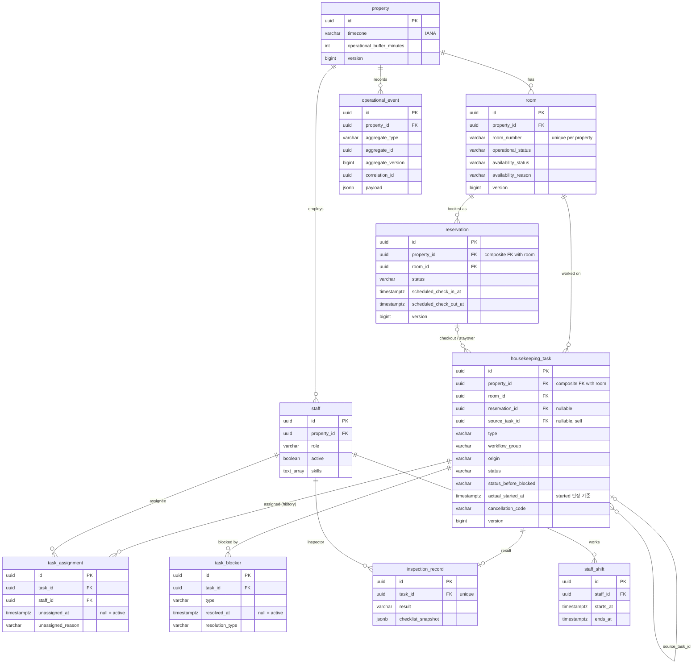

# StayOps DB 스키마 (V1)

- 기준: `apps/api/src/main/resources/db/migration/V1__core_schema.sql` (+ V2 idempotency_record, V3 배정 종료 사유 `MANUAL_UNASSIGN`)
- 도메인 규칙 출처: `docs/v4.1/02_DOMAIN_AND_API.md` §2, §10
- 검증: `apps/api/src/test/kotlin/com/stayops/schema/SchemaConstraintTests.kt` (PostgreSQL 17, Testcontainers, 37 tests)
- 상태: `IMPLEMENTED` / 아래 표의 각 제약은 `VERIFIED`

## ERD

## 도메인 규칙 → DB 제약 대응

| 규칙 (02 v4.1) | 제약 이름 | 종류 |
|---|---|---|
| 객실 번호는 property 내 유일 | `room_number_unique_per_property` | UNIQUE |
| OOS는 사유 필수 | `room_oos_requires_reason` | CHECK |
| 예약 `[checkIn, checkOut)` 유효 구간 | `reservation_interval_valid` | CHECK |
| 같은 객실 활성 예약 시간 겹침 금지 (ADR-004) | `reservation_no_overlap` | EXCLUDE (gist) |
| 객실당 CHECKED_IN 예약 1개 | `reservation_one_checked_in_per_room` | partial UNIQUE |
| CHECKED_IN/OUT은 실제 시각 필수 | `reservation_checked_in_has_time`, `reservation_checked_out_has_time` | CHECK |
| 예약·task의 객실은 같은 property | `reservation_room_same_property`, `task_room_same_property` | composite FK |
| 직원 근무시간 겹침 금지 | `staff_shift_no_overlap` | EXCLUDE (gist) |
| 객실당 active ROOM_WORKFLOW task 1개 (§2.9, ADR-003) | `task_one_active_workflow_per_room` | partial UNIQUE |
| BLOCKED ⇔ statusBeforeBlocked 존재 | `task_blocked_iff_status_before_blocked` | CHECK |
| CANCELLED ⇔ cancellationCode 존재 | `task_cancelled_iff_cancellation_code` | CHECK |
| 수동 취소는 사유 필수 | `task_manual_cancel_requires_reason` | CHECK |
| MANAGER_REWORK는 originReason 필수 | `task_rework_requires_reason` | CHECK |
| IN_PROGRESS는 시작 시각 필수, COMPLETED는 시작·완료 시각 필수 | `task_in_progress_has_start`, `task_completed_has_times`, `task_completed_after_start` | CHECK |
| type × origin × reservation/source 연결 | `task_type_origin_consistent` | CHECK |
| checkout cleaning은 예약당 1개 | `task_one_checkout_cleaning_per_reservation` | partial UNIQUE |
| task당 활성 assignment 1개 | `assignment_one_active_per_task` | partial UNIQUE |
| 배정 종료 시각과 사유는 함께 | `assignment_unassigned_pair` | CHECK |
| blocker 종결 시 시각·유형·처리자 함께 | `blocker_resolution_consistent` | CHECK |
| OTHER blocker는 설명 필수 | `blocker_other_requires_description` | CHECK |
| 검사 task당 결과 1건 | `inspection_record_task_id_key` | UNIQUE |
| FAILED는 실패 사유 필수 | `inspection_failed_requires_reason` | CHECK |
| STAFF actor 이벤트는 actor id 필수 | `event_staff_actor_has_id` | CHECK |

## DB로 보장하지 않는 규칙 (서비스 + 테스트로 보장, P2.5 이후)

| 규칙 | 이유 | 보장 위치 |
|---|---|---|
| BLOCKED ⇔ 활성 blocker ≥ 1 | 테이블 간 집계 조건 | 서비스 transaction + consistency test |
| terminal task에 활성 assignment 없음 | 테이블 간 조건 | 서비스 + consistency test |
| started active task면 Room이 진행 상태 | 테이블 간 조건 | 서비스 + property-based test (05 §6) |
| 배정 가능 역할 (HOUSEKEEPER/INSPECTOR) | staff·task 조인 필요 | 서비스 (P4) |
| event aggregateVersion 단조 증가 | 동일 command 내 다건 이벤트 허용 필요 | 이벤트 기록 서비스 (P2.5) |

## v4.1 문서 대비 구현 시 구체화한 점

| 항목 | 02 v4.1 | 구현 |
|---|---|---|
| checkout task 유일성 | "unique (reservationId, type) where reservationId not null" | stayover는 예약당 여러 번 생성되므로 **CHECKOUT_CLEANING에만** 적용 |
| STAYOVER_CLEANING의 reservationId | 명시 없음 | **필수** (투숙 예약에 연결) |
| 예약 겹침 | OPEN | ADR-004: exclusion constraint |
| 추가 제약 | – | 객실당 CHECKED_IN 1개, 직원 근무 겹침 금지, type×origin 일관성, 실제 시각 필수 |
| 시각 컬럼 | timestamptz | 동일. Hibernate `jdbc.time_zone=UTC` |
| JSON 컬럼 | JSONB | 엔티티에서는 JSON 문자열로 보관, 직렬화는 애플리케이션 계층 |
